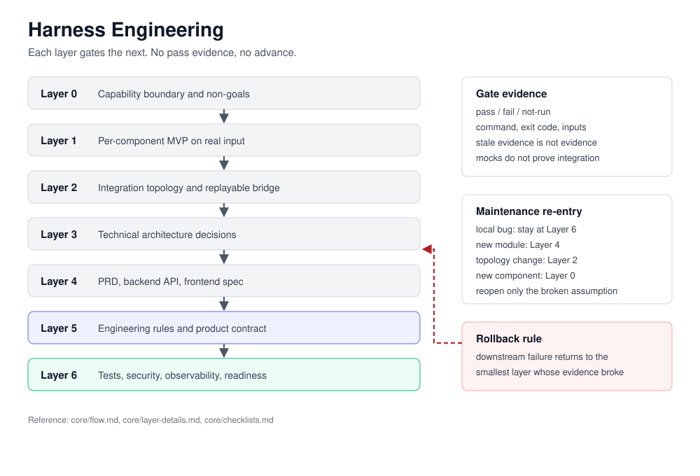

# Harness Engineering

[](https://github.com/suiuiui6/harness-engineering-skill/actions/workflows/integration.yml)
[](LICENSE)

**Your coding agent says the project is done. Harness Engineering makes it prove it, layer by layer.**

Harness Engineering is a seven-layer delivery method for AI-assisted software work. Every layer produces artefacts and gate evidence; the next layer starts only after the previous one passes. When a downstream failure invalidates an upstream assumption, work returns to the smallest broken layer instead of restarting the project.

It is not a test framework and not a prompt pack. It is the ordering and evidence discipline that sits above both.



## Why it exists

AI coding agents are optimistic. A command exits `0`, a mock replaces the real API, a dependency is incompatible, an old test result gets reused, and the final report still says "complete".

Harness Engineering turns each of those into a checkable state:

- **Layer 0** — what each component can and cannot do, verified against source or API, not documentation.
- **Layer 1** — every component runs once on real input before it is integrated.
- **Layer 2** — each bridge stage has an input/output contract and a replayable run.
- **Layer 3** — architecture decisions are traceable to validated components.
- **Layer 4** — three blueprints that do not contradict each other.
- **Layer 5** — engineering rules and a product contract with testable acceptance criteria.
- **Layer 6** — tests, security, observability and production-readiness checks.

## Quick start

Claude Code:

```bash
git clone https://github.com/suiuiui6/harness-engineering-skill.git \
  ~/.claude/skills/harness-engineering
```

Then ask for the structured flow explicitly, or use `/harness-engineering` if you have wired the slash command from `adapters/claude-code/assembly.md`.

Codex:

```powershell
git clone https://github.com/suiuiui6/harness-engineering-skill.git `
  "$env:USERPROFILE\.codex\skills\harness-engineering"
```

`SKILL.md` is the entry point. `core/` holds the protocol, `adapters/` holds host mapping, `references/` holds methodology and the four agent templates.

OpenCode notes live in `adapters/opencode/`. They are a compatibility entry, not a verified end-to-end integration — check them against your host before relying on them.

## How a session runs

1. Classify the request as `bootstrap` or `maintenance`.
2. Choose the smallest layer where evidence is actually missing.
3. Read only the core files needed for that scope.
4. Do not cross a gate without pass evidence.
5. On failure, roll back to the smallest invalid upstream layer.
6. Close with touched layers, evidence pointers, and operation state.

Maintenance is not a restart. A local bug fix stays at Layer 6. A topology change re-enters Layer 2. A new core component re-enters Layer 0.

## Evaluation

The repository ships its evaluation data, including results that do not flatter the method. Read [docs/BENCHMARK.md](docs/BENCHMARK.md) before quoting any number.

Short version: single-run results across three iterations do not show a stable pass-rate advantage for the skill. They do show large token and wall-clock savings when the method is packaged as a compact brief. The evaluation harness is published so the claim can be checked and contested, not so a percentage can be put on a badge.

## Repository map

| Path | Contents |
| --- | --- |
| `SKILL.md` | Canonical entry point and execution rules |
| `core/` | Layer flow, layer details, checklists, exit and re-entry |
| `adapters/` | Claude Code, Codex and OpenCode mapping |
| `references/` | Methodology, agent templates, permissions matrix |
| `evals/` | Benchmark data and runner notes, iterations 1–3 |
| `goal/` | Goal intake companion, formerly the standalone `goal-skill` repository |
| `docs/` | Architecture asset, benchmark write-up, archive |

## When to use it

Use it when the work has two or more external components, an uncertain tech stack, an integration that has not been proven, or a team that needs the same definition of "done".

Skip it for a single-file fix, a feature with a settled design, a single-service project, or an already stable maintenance task.

See [CONTRIBUTING.md](CONTRIBUTING.md) and [SECURITY.md](SECURITY.md).

## Case study

[graghRAG-agent](https://github.com/suiuiui6/graghRAG-agent) is a multimodal GraphRAG application built with this method. Its Layer 0–6 documents are the practical reference for what the outputs look like.

## License

MIT.
