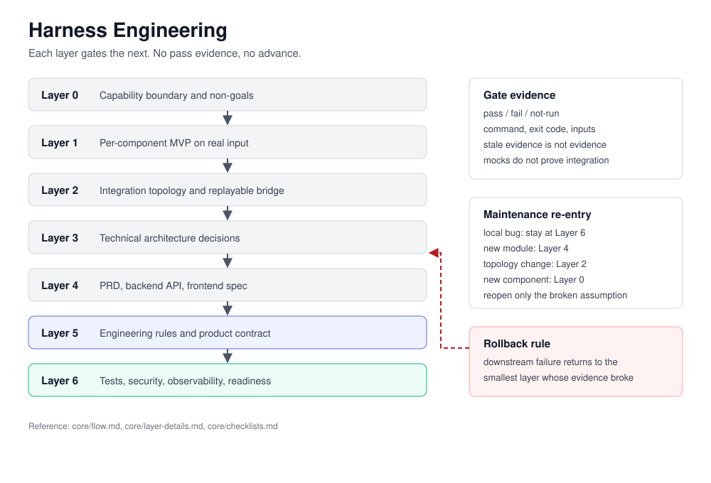

# Harness Engineering

[](https://github.com/suiuiui6/harness-engineering-skill/actions/workflows/integration.yml)
[](LICENSE)

**AI 编码 Agent 说项目做完了。Harness Engineering 让它按层拿出证据。**

这是一套面向 AI 辅助开发的 7 层交付方法。每一层必须产出可检查的工件与门禁证据，下一层才能开始；下游失败推翻上游假设时，只回到最小的失效层，不重启整个项目。

它不是测试框架，也不是提示词合集，而是位于两者之上的执行顺序与证据纪律。



## 为什么需要它

AI 编码 Agent 天生乐观。命令退出码是 `0`、mock 顶替了真实 API、依赖版本不兼容、旧测试结果被复用，最终报告依然写着"完成"。

Harness Engineering 把这些情况变成可判定的状态：

- **Layer 0**：每个组件能做什么、不能做什么，以源码或 API 为准，不以文档为准。
- **Layer 1**：每个组件先用真实输入跑通一次，再谈集成。
- **Layer 2**：每段桥接都有输入输出契约和可复现的运行记录。
- **Layer 3**：架构决策可追溯到已验证的组件。
- **Layer 4**：三份互不矛盾的蓝图。
- **Layer 5**：工程规则与含可验证验收标准的产品契约。
- **Layer 6**：测试、安全、可观测性与生产就绪检查。

## 快速开始

Claude Code：

```bash
git clone https://github.com/suiuiui6/harness-engineering-skill.git \
  ~/.claude/skills/harness-engineering
```

Codex：

```powershell
git clone https://github.com/suiuiui6/harness-engineering-skill.git `
  "$env:USERPROFILE\.codex\skills\harness-engineering"
```

`SKILL.md` 是入口，`core/` 是协议本体，`adapters/` 是宿主映射，`references/` 是方法论与四个 Agent 模板。

OpenCode 相关文件位于 `adapters/opencode/`，属于兼容入口，尚未做过端到端验证，使用前请自行核对。

## 一次会话怎么跑

1. 判定 `bootstrap` 还是 `maintenance`。
2. 选择证据真正缺失的最小编号层。
3. 只读该 scope 需要的 core 文件。
4. 没有通过证据，不跨层。
5. 失败时回退到最小的失效上游层。
6. 收尾时报告 touched layers、证据指针与 operation state。

维护期不是重新开始：局部 bug 留在 Layer 6，拓扑变化回到 Layer 2，引入新核心组件回到 Layer 0。

## 评测

仓库公开了评测数据，包括不利于方法论的结果。引用任何数字前先读 [docs/BENCHMARK.md](docs/BENCHMARK.md)。

结论很短：三轮单次运行的结果并未显示该 skill 有稳定的通过率优势；可以确认的是，把方法压缩成本地简报后，token 与耗时显著下降。评测框架公开的目的，是让结论可以被复现和反驳，而不是把一个百分比印在徽章上。

## 目录

| 路径 | 内容 |
| --- | --- |
| `SKILL.md` | 入口与执行规则 |
| `core/` | 层流程、层细节、检查清单、退出与重入 |
| `adapters/` | Claude Code、Codex、OpenCode 映射 |
| `references/` | 方法论、Agent 模板、权限矩阵 |
| `evals/` | 第 1–3 轮评测数据与运行说明 |
| `goal/` | Goal 入口检查，原 `goal-skill` 仓库 |
| `docs/` | 架构图、评测说明、归档 |

## 何时使用

适用：涉及两个以上外部组件、技术栈不确定、集成尚未验证、团队需要统一的"完成"定义。

不适用：单文件修复、方案已定的功能开发、单服务项目、已经稳定的维护期任务。

贡献方式见 [CONTRIBUTING.md](CONTRIBUTING.md)，安全问题见 [SECURITY.md](SECURITY.md)。

## 案例

[graghRAG-agent](https://github.com/suiuiui6/graghRAG-agent) 是用这套方法构建的多模态 GraphRAG 应用，其 Layer 0–6 文档可以直接看到各层产物长什么样。

## 许可证

MIT。
